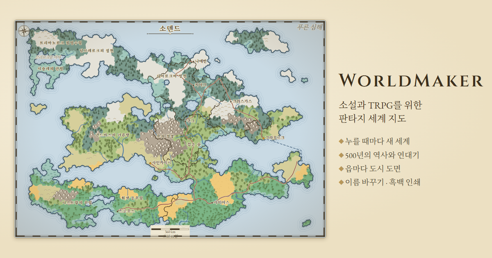

# WorldMaker

**[한국어](#한국어) · [English](#english)**

**▶ https://kutanxx.github.io/WorldMaker/**

---

## 한국어

소설가와 TRPG 게임 마스터를 위한 **판타지 세계 지도 생성기**입니다. 버튼 하나로 대륙과 나라, 도시, 500년의 역사까지 가진 세계를 만들고, 지도는 작가의 결과물로 다듬어 내보낼 수 있습니다.

### 무엇을 할 수 있나요

**세계 지도**
- 대륙·바다·산맥·강·기후에 따른 생물군계를 가진 세계를 만듭니다. 강은 수원에서 바다까지 흐르고, 해안은 물결선으로 그린 손그림 지도처럼 그려집니다.
- 네 가지 보기: **지형 · 정치 · 문화 · 행정 구역**. 그리는 방식은 셋 — **컬러**, 오래된 지도책 같은 **세피아**, 인쇄용 **흑백**.
- 확대·이동, 지도만 크게 보기, 범례와 도시 목록.

**500년의 역사**
- 나라들이 세력을 키우고, 정복하고, 내전으로 갈라지고, 자유 도시가 서는 과정을 500년 동안 시뮬레이션합니다(Turchin식 결속력 모델).
- 연표를 끌거나 ▶ 재생으로 국경이 변하는 것을 보고, 그해에 일어난 일을 한 줄 연대기로 읽습니다.

**도시 도면**
- 지도 위 도시를 누르면 그 도시만의 중세 도면이 열립니다. 성벽·성문·성채·구역·시장·강과 다리·항구·성 밖 마을까지, 도시가 선 자리(강가, 바닷가, 산, 숲)에 맞춰 그려집니다.
- 도면의 길은 세계 지도에서 실제로 이어진 이웃 도시 방향으로 나갑니다.

**이름과 언어**
- 지역마다 같은 문화의 소리로 이름을 짓습니다. 한국어로 볼 때는 한글 이름과 "왕국·제국·공화국" 같은 이름표가 붙습니다.
- 화면 전체를 **한국어 ↔ 영어**로 바꿀 수 있습니다.
- **이름 바꾸기**: 지도 위에서 도시·지역·나라 이름을 직접 고칠 수 있고, 고친 이름은 링크에 저장됩니다.

**내보내기와 공유**
- **PNG · SVG** 지도, 필요한 **지역만 잘라 내보내기**, **JSON** 세계 데이터, **세계 안내서**(Markdown 지명 사전과 연대기).
- **같은 링크는 언제나 같은 세계**입니다. 세계는 번호(시드)에서 계산되므로, 링크를 보내면 상대도 같은 지도·역사·도면을 봅니다. 화면 아래의 **지문**(예: `1C6B-DC73`)으로 다른 브라우저에서 똑같이 만들어졌는지 확인할 수 있습니다.
- **오늘의 세계**: 날짜마다 하나씩, 같은 날짜면 모두가 같은 세계를 봅니다.
- 최근에 본 세계 목록, 링크 복사.

**세계 설정**
- 해수면, 산의 높이, 나라 수(2~12), 도시 수(4~60), 지도의 세밀함(칸 1,200~9,000)을 바꿔 새 세계를 만들 수 있습니다.

### 사용법

1. [첫 화면](https://kutanxx.github.io/WorldMaker/)에서 **세계 만들기**를 누르거나, 원하는 이름을 넣어 그 이름으로 세계를 시작합니다.
2. 지도에서 보기를 바꾸고, 연표를 움직여 역사를 보고, 도시를 눌러 도면을 엽니다.
3. 마음에 드는 세계는 링크를 저장하거나 공유하고, 필요한 형식으로 내보냅니다.

데스크톱 브라우저에 맞춰 만들었습니다(휴대폰에서도 열리지만 주 화면은 데스크톱입니다).

---

## English

A **fantasy world map generator** for novelists and tabletop game masters. One click makes a world with continents, realms, towns and 500 years of history, and the map is yours to refine and export as an author's artifact.

### What it does

**World map**
- Continents, seas, mountain ranges, rivers and climate-driven biomes. Rivers run from source to sea, and the coast is drawn with ripple lines like a hand-drawn atlas.
- Four views: **Terrain · Political · Culture · Provinces**, drawn in one of three styles — **Colour**, **Sepia** like an old atlas, or a black-and-white **Ink** map for print.
- Zoom and pan, a map-only view, a key and a town list.

**500 years of history**
- Realms rise, conquer, split in civil wars and see free cities founded over 500 simulated years (a Turchin-style solidarity model).
- Drag the timeline or press ▶ to watch the borders move, and read each year's events as a one-line chronicle.

**Town plans**
- Click a town on the map for its own medieval plan: walls, gates, castle, wards, market, river and bridges, harbour and suburbs, shaped by where the town stands (river, coast, mountains, forest).
- A plan's roads leave toward the neighbouring towns they actually lead to on the world map.

**Names and languages**
- Each region names its places in the sound of its own culture. In Korean, names are written in Hangul with titles such as kingdom, empire or republic.
- The whole interface switches between **English and Korean**.
- **Rename**: edit any town, region or realm name right on the map; your names are kept in the link.

**Export and share**
- **PNG / SVG** maps, **export just a region**, **JSON** world data, and a **Gazetteer** (a Markdown almanac and chronicle).
- **The same link is always the same world.** A world is computed from its number (seed), so whoever opens your link sees the same map, history and plans. The **fingerprint** under the map (e.g. `1C6B-DC73`) lets you check another browser built exactly the same world.
- **Daily World**: one per date. On the same date, everyone sees the same world.
- Recently viewed worlds, copy link.

**World settings**
- Change sea level, mountain height, the number of realms (2–12), towns (4–60) and the map's detail (1,200–9,000 cells) to make a new world.

### How to use

1. On the [front page](https://kutanxx.github.io/WorldMaker/), press **Create**, or type a name to start a world from it.
2. Switch views, scrub the timeline to watch history, and click a town to open its plan.
3. Keep or share the link to a world you like, and export it in the format you need.

Made for desktop browsers (it opens on a phone, but the desktop is the main screen).
